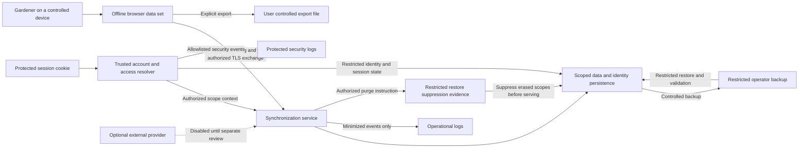

# Access data inventory and lifecycle

> 2026-10-17 status: Authentication inventory revision pending: verified email, SMTP delivery and invitation/reset tokens replace the no-email/passkey/recovery-code baseline. Other inventory categories remain applicable. See the
> [Spring email/password replacement plan](../development/spring-email-authentication-plan.md).

- Status: Accepted S1 inventory and lifecycle design, 2026-10-02.
- Authority: [ADR-0029](../architecture/decisions/0029-access-and-synchronization-scope.md) and
  [ADR-0015](../architecture/decisions/0015-privacy-and-observability.md).
- Implementation: S5-S6 and S8-S15 of the
  [access plan](../development/access-and-synchronization-scope-implementation-plan.md), P0.6,
  and applicable deployment work. This inventory is not a deployment compliance finding.

## Classification and protection

Classify public installation capabilities and external catalog reference data as **public** when not
linked to a person. Classify garden/history/location data, user labels, account/device metadata,
bindings, stable identifiers, synchronization state, and linkable diagnostics as **personal**. Treat
passwords/hashes, session cookies, recovery/enrollment material, provider/backend credentials, and
private keys as **secret**. Encoding, pseudonymization, or removing names does not make linkable data
anonymous. Free-form content may contain unexpected sensitive information and is never logged.

Personal data requires authorized scope access, controlled local/device storage, TLS in deployment,
protected server volumes/backups, bounded lifecycle, and no disclosure to trackers or default external
providers. Secret data additionally needs narrow access and established cryptographic handling;
credentials never enter browser script storage, business exports, ordinary/security logs, or examples.
Production encryption/key-management choices and evidence belong to S8/S15 and deployment work.

## Data flow and recipients

Standalone data stays in the user's browser/device. After opt-in binding, recipients are the authorized
account's enrolled devices and the configured operator's server/storage infrastructure. Operator
administration has potential host/database access; application gardener roles do not automatically
grant cross-account access. Backup/support access is exceptional, documented, and restricted. The
project adds no Hortinis-operated account service, telemetry recipient, third-party runtime asset, or
mandatory email/identity provider. A provider's activation requires its own purpose, minimized payload,
recipients, location/transfers, terms, and lawful-basis review.

## Inventory and proposed lifecycle

ADR-0023's synchronization periods and the [S8 authentication numeric policy](../architecture/authentication-and-sessions.md#numeric-policy)
are accepted design. S8 values remain inactive until their adapters pass; other operational/backup
periods below remain proposals for S15/operator assessment. A deployment must record its effective
values and justification, implement automatic purge, and close the blockers below before
real-data use. Account inactivity alone does not discard garden history or unresolved local intent.

| Category and fields | Purpose and location/recipients | Retention and deletion |
| --- | --- | --- |
| Garden content, corrections/history, approximate location when separately specified | Requested garden memory and synchronization; selected browser data set and authorized server scope/devices. Precise location is not required or newly authorized by S1. | Retain while the requested history service/data set continues; delete server copies on complete scope deletion and local copies on explicit local deletion. No automatic local age expiry or undocumented inactive-account purge. |
| Local data-set ID and binding: origin, instance, scope/account identity, mode, progress | Prevent accidental transfer and detect replacement/account changes; browser only except necessary authorized handshake fields. | Retain with the local data set and recovery provenance; remove on explicit data-set deletion. No credentials; disconnection does not infer a new owner. |
| Pending operations, bases, accepted results, conflicts, quarantined rejections, indeterminate work | Preserve offline intent and prove replay/reconciliation; selected local data set. May contain garden content. | Until resolved, explicitly discarded, or selected data set deleted; never expire pending intent by age. Completed state uses the implementing task's bounded cleanup while preserving recovery evidence. |
| Accepted browser live-record projection and legacy repair cursor | Preserve latest server values independently of pending intent; browser only, within the same data-set boundary. | Replace values monotonically; remove live accepted state on tombstones; delete with the data set. Repair metadata contains only scope/cursor state and is removed when repair completes. Never log values or cursors. |
| Submission markers and legacy uncertainty | Freeze operation bodies before dispatch and preserve replay after migration; browser only, with the outbox or retained rejection. | Retain with the operation and recovery evidence; no historical timestamp is invented for legacy rows. Never expose content in diagnostics. |
| Retry state and tab leases: work IDs, attempts, phase, ephemeral owner, fence, expiry | Bounded retry and coordination; browser only. | Retain active/exhausted work until outcome/manual recovery; Expire released leases while retaining one bounded scope row for fencing continuity. Delete with the data set; no copied request bodies or content in retry diagnostics. |
| Server instance/scope/account IDs, ownership relationship, scope publication counter, and sole technical role | Installation mismatch detection, partitioning, authorization; server, with minimum authorized identity exposed to binding. | Instance ID follows installation lifecycle; account/scope IDs and ownership last until deletion. Never reuse; public discovery omits account/scope identity. |
| Account login identifier and credential verifier; recovery attributes only if justified by S8 | Autonomous authentication/recovery; restricted identity storage. Do not require an email address or external provider by assumption. | Account lifetime, then purge during deletion. Superseded verifiers/secrets follow bounded S8 cleanup; do not archive obsolete credentials in ordinary account tables. |
| Session records/cookies, CSRF and bootstrap/recovery/enrollment secrets | Authentication and request/replay protection; restricted server records and protected necessary cookie/in-memory token handling. | Enforce S8's finite idle/absolute/one-time limits; invalidate at logout, revocation, disablement, or deletion. S8 specifies bounded physical cleanup; termination immediately removes authorization. Never store session secrets in IndexedDB/localStorage/sessionStorage. |
| Device ID, enrollment status, optional user label, justified activity timestamps | User-visible device management/revocation; account identity store and authorized account UI. No fingerprinting or precise location. | Active enrollment lifetime; revoke immediately and purge obsolete metadata under a bounded S11/S15 rule. Purge on account deletion; labels are never logged. |
| Active-generation changes/tombstones and retired-generation receipts | Ordered synchronization and acceptance proof; authorized scope. Payloads may contain former garden values. | ADR-0023: default 90 days active history, 30 days retired receipts; supported minimum 7 days each. Rollover precedes compaction; scope deletion overrides retention and purges them. |
| Snapshot/reconciliation sessions | Anchored, resumable reconciliation; authorized temporary server/browser state. | ADR-0023: default 24 hours, minimum 1 hour. Purge automatically after expiry/completion under accepted cleanup rules; scope deletion purges immediately through its workflow. |
| Retired record-identifier reservations | Prevent stale resurrection; authorized server scope, no former record values. | Scope lifetime under ADR-0024; purge when the scope is destroyed. Never recreate that scope/record ownership from stale client input. |
| Operational events: UTC time, fixed event/method/route template, status, duration, fresh request/trace reference | Availability diagnosis; operator-controlled logging. Treat linkable event references as personal metadata. | Proposed rolling 30 days, with purpose justification and automatic rotation/purge in S15. No bodies, credentials, stable account/scope/device/record/operation IDs, raw addresses, concrete routes, or query values. |
| Security events: UTC time, fixed event/outcome/reason and fresh request reference | Detect/investigate authentication/authorization abuse; separate restricted security store. S8 baseline has no subject mapping, raw session/account/scope/device IDs, addresses or attempted login strings. | S8 accepts rolling 30 days with daily and overdue startup purge; S15 verifies access/purpose and effective operator policy. A future subject mapping or legal hold needs a separate minimized purpose and bounded review, not automatic retention. |
| Network source addresses and transient abuse counters | Establish connections and defend against excessive attempts; infrastructure/resolver memory with trusted proxy handling. | Process transiently; no raw IP persistence in application/proxy logs. S8/S15 specifies bounded limiter keys/windows and their privacy inventory before use. No durable tracking or account analytics. |
| Server backups, volume/database snapshots and protected operational restoration copies | Recover installation data; restricted operator storage. May contain every backed-up personal/secret category. | Proposed maximum rolling 30 days, subject to justified operator choice in P0.6/S15. Encrypt/restrict access; purge expiry; suppress deleted accounts/scopes before serving any restored copy. Backups are not an indefinitely retained archive. |
| Purge progress and minimal restore-suppression evidence: deleted opaque identity, deletion time/status, affected backup boundary | Resume erasure and prevent restoration resurrection; restricted store protected from rollback with affected backups. | Until purge completes and all affected backups expire or are erased, then purge automatically. No garden content or credentials; retain longer only under a specific documented legal obligation/hold. |
| User business-data export | Requested portability/backup; explicit user-controlled file. | Never include session/recovery/backend secrets. User controls exported-copy retention; disclose that server/local deletion cannot retrieve all exports. Version/restore semantics belong to P0.6. |
| Public catalog/capabilities | Offline reference facts and compatibility discovery. | Reference-data version policy; not personal in isolation. A personal plant selection or account-bound capability response inherits personal classification. |

## Complete deletion and restoration

S2 refines metadata representations without activating new processing: local version-one binding and
exchange fences remain browser-only, public discovery excludes account/scope identity, and authorized
bootstrap exposes only the required destination identity. The non-secret exchange expectation is
transient, excluded from local binding persistence and all logs. S6 must specify its bounded handshake
lifecycle and purge before persisting it. S2 fixed errors expose no identity or content and declare
`Cache-Control: no-store`; actual transport/caching behavior remains adapter evidence. All parsing
fixtures are synthetic. See [access contracts](../api/access-and-binding-contracts.md).

Separate account closure from scope erasure, local browser deletion, and user-managed export disposal.
Explain these boundaries before confirmation. Offer export and identify the destination being deleted;
do not make keeping a backup a prerequisite to exercising deletion rights.

The [access specification](../architecture/access-and-synchronization-scope.md) defines the ordered
deny/revoke/purge workflow. The server first blocks access atomically, then purges all categories through
idempotent steps. Purge failure remains denied, resumable, and visible to the operator. Account deletion
must not retain tombstone/reservation identifiers forever simply to preserve a destroyed scope.

Preserve minimal deletion instructions independently of backup rollback. Restore into an inaccessible
environment, apply those instructions, invalidate stale session/enrollment credentials, establish the
new installation identity for rolled-back state, and verify authentication mode before serving. If
deletion evidence cannot be established, restored data remains inaccessible pending controlled
recovery. Test restores from backups taken before and during deletion.

Browser deletion fences tabs and in-flight responses and removes the selected data set and its work.
Explain that browser/OS caches, device backups, flash storage, extensions, and user exports prevent a
guarantee of secure physical erasure. Account revocation cannot remotely wipe a disconnected device.
Sign-out retains local garden access by the accepted product decision; disclose shared-profile risks.

## Controller/operator processing record and user information

The operator documents the actual controller/processor roles, GDPR applicability, recipients, and any
household-use exception assessment. Installing self-hosted software does not automatically settle
those roles. The project supplies code/design guidance, not a universal lawful-basis determination.

Before a deployment stores real personal data, complete a processing-purpose record with: operator
identity/contact and privacy contact; data subjects/categories; each purpose; Article 6 lawful-basis
decision and assessment; necessary attributes; recipients/processors/contracts and transfers; storage
locations; actual retention/backup periods; safeguards; rights channel; legal holds; and accountable
review date/owner. No placeholder, default consent, or undefined basis authorizes processing.

Publish accessible information distinguishing local-only use from server binding: who operates the
server, what data is sent, access-mode limits, providers and transfers, cookies, retention, backups,
rights/contact/complaint route, local retention after sign-out/revocation, export/deletion limits, and
changes in processing. Necessary session cookies have a documented functional purpose; provider and
analytics activation still require their own accepted information/legal gates.

## Rights handling, incidents, and DPIA screening

Provide an operator procedure for receiving, verifying, and tracking applicable access, rectification,
erasure, restriction, objection, and portability requests. Verify identity proportionately without
collecting unnecessary identity documents. Record due dates, legal exceptions/holds, affected stores,
recipient actions, and the response; avoid user content in ordinary support logs. Authentication or
operational recovery must not silently defeat account ownership or legal deletion. S15 verifies the
procedure and P0.6 supplies usable export/restore behavior.

The incident procedure identifies the on-call operator/contact, records discovery time, contains the
incident, revokes compromised access, preserves minimal protected evidence, assesses affected categories
and persons, and documents the reporting/notification decision. Assess Articles 33/34 obligations:
notify the competent authority where required without undue delay and, where feasible, within 72 hours
of awareness; communicate to affected people where the applicable high-risk condition is met. Record
decisions and follow-up even where notification is not required. Production contact/escalation details
are operator records, not committed environment-specific configuration.

Before real-data use, screen the actual deployment for Article 35 high-risk processing and applicable
CNIL criteria/lists. Consider scale, vulnerable users, unexpected sensitive free text, location
precision, monitoring/profiling, linked datasets, external recipients, and new processing features.
Record the reasoned DPIA-required/not-required result, reviewer, assumptions, and revisit triggers.
No blanket result is assigned to all self-hosted installations. If required, complete the DPIA and
address residual high risk before processing; seek qualified review where necessary.

## Blocking work and authoritative sources

S8 settles factor/recovery/session/enrollment policy and data minimization; S9-S12 must implement and
verify the selected controls and cleanup. P0.6/S12/S15 must
settle numeric log/backup/cleanup periods, implement deletion and restore suppression, verify logs at
every layer, and document operator safeguards. The operator must complete the legal-purpose/rights,
processor/transfer, incident, and DPIA records. Unresolved entries block real personal-data deployment;
they do not prevent synthetic G2f validation. Review the ASVS offline-storage deviations at S15.

Normative reference: [GDPR](https://eur-lex.europa.eu/eli/reg/2016/679/oj), especially Articles 5, 6,
12-22, 25, 28, 30, and 32-36. Implementation references:
[CNIL developer guide](https://www.cnil.fr/en/gdpr-developers-guide),
[user profiles](https://www.cnil.fr/en/sheet-ndeg8-manage-user-profiles),
[retention](https://www.cnil.fr/en/sheet-ndeg14-define-data-retention-period), and
[personal-data security guide](https://www.cnil.fr/sites/default/files/2024-03/cnil_guide_securite_personnelle_ven_0.pdf).
S8 selects a minimized 30-day baseline security-event period for local abuse investigation. This is
an application design choice, not a universal statutory period; S15/operator purpose review remains required.

## S3 synthetic partitioning handoff

S3 persists installation/scope identifiers, a per-scope publication counter, and the sole technical
scope designation in PostgreSQL. These implement the existing mismatch-detection and partitioning
purposes above; no account, ownership inference, credential, garden/location field, recipient, or
production retention policy is introduced. Instance/scope identifiers also fence the opaque cursor;
identifiers and cursors remain excluded from logs. Only synthetic technical fixtures are authorized.
Fresh developer installation reset deletes the synthetic database/browser state explicitly. Account
purge, backup restore suppression, and processing real personal data remain S12/S15/operator gates.

## S4 configuration and request-resolution handoff

S4 adds the committed access mode to the existing installation inventory for fail-closed startup and
configuration consistency. It is operator configuration, introduces no new personal-data category or
recipient, and shares installation lifetime/reset behavior. The runtime resolves the current designated
scope per request and verifies context at persistence. No account/session/device credential is created.
The public browser origin is explicit operator configuration, kept out of diagnostics and retained
with deployment configuration; it introduces no user-content storage. Origin/Fetch Metadata is inspected transiently for mutation protection, never persisted or logged;
credential-header canaries and request content remain excluded from diagnostics. The static no-auth
warning contains only configuration information. No new security-log store or retention policy exists.
Existing purpose, access restrictions, deletion/backup/restore obligations, and operator readiness gates
continue to apply; S4 evidence uses synthetic fixtures only.

## S5 local ownership handoff

S5 generates and persists the existing `localDataSetId` category offline in one singleton per Dexie
database. Its purpose is local ownership, reload continuity, response/retry fencing, and future binding
provenance; no recipient, account credential, or telemetry is added. Physical ownership covers all
records, tombstones, pending/accepted operations, accepted bases, conflicts/rejections, cursors, retries,
leases, and local binding. Identity metadata and non-secret provenance share the selected data set's
local lifetime and the existing explicit deletion/eviction/export lifecycle; no automatic retention
or purge policy is introduced. Tests remain synthetic.

Opening the same local database retains identity; another database creates its own identity without
inheriting data. Existing unowned data is preserved and rejected instead of assigned or migrated.
Initial identity creation and local projection/outbox writes are atomic. Malformed metadata/binding
fails closed, and no password, session identifier, access token, or refresh token is accepted in local
binding storage. Schema failure exposes only a generic unavailable-storage message and no content/ID.

This is no authentication or XSS/shared-device protection. All data sets in a browser origin remain
accessible to that origin's scripts and a person with access to the profile; logout retains offline
access under the accepted design. Browser eviction/reset, extensions, snapshots, and exports remain
within the documented privacy boundary. User selection, cloning, local deletion, and backup/restore
suppression remain S12/P0.6/S15 workflows; no secure-erasure claim is made.

## S6 handshake metadata lifecycle

Explicit first connection exposes only public compatibility and the currently authorized destination
identity. Local-only startup performs no discovery or content exchange. The shell discloses that
connecting permits pending changes to be sent to this server. No external provider, telemetry,
credential storage, or new recipient category is introduced; all evidence remains synthetic.

Server expectations are non-secret, scope-owned protocol state with a 15-minute absolute lifetime,
a 128-row per-scope limit, issuance cleanup and scheduled 60-second cleanup. Reobservation/confirmation
never extends expiry. Browser initial admission is a separate owner/fence-bearing row with a
10-minute deadline. An active-page timer and access/startup purge remove the token on expiry; a closed
browser cannot run a timer, so cleanup occurs at next use. Known successful acceptance/pull removes
progress atomically. Interrupted or ambiguous exchange preserves provenance and pending intent;
expiry retains only an uncertain phase, without the expectation. Bindings retain their existing
local-data-set lifetime. Expectations, identities, content, and provider diagnostics are never logged.
Backups may retain expired metadata until their separately reviewed backup purge boundary; expired
rows cannot authorize exchange, and restore-suppression/identity changes remain S12/S15 requirements.

Same-origin scripts and profile users can read this local metadata. This implements no local secrecy,
authenticated isolation, secure erasure, or production privacy/legal readiness. A changed destination
pauses exchange and advances the fence; delayed responses cannot commit. Populated-state first binding
remains blocked until S14 reconciliation, and production retention/access restrictions remain gates.

## S7 synthetic topology evidence

S7 introduces no production data category, recipient, processing path, credential or telemetry. Its
separate launcher provisions synthetic A/B scopes only in disposable topology volumes; normal artifacts
and runtime cannot load that fixture. The test marker is neither a credential nor server-authorized
membership for a real user. Disposable contexts hold synthetic local data under their independent
existing local owners and bindings.

Topology evidence exercises scope/receipt/cursor/tombstone/retirement isolation, ambiguous intent and
retained state after real service restart. Captured diagnostics exclude values, stable identities,
expectations and credential canaries. Synthetic test traces may contain their test content and are
excluded from source control; normal production logging restrictions remain unchanged. Runner cleanup
removes only its generated project containers, volumes and network, including failure paths. This is
no authenticated isolation, production log/backup retention, secure-erasure, lawful-basis or GDPR
readiness evidence; the S8-S15/P0.6 and deployment gates remain applicable.

## S8 selected authentication inventory and purposes

[ADR-0033](../architecture/decisions/0033-built-in-authentication-and-sessions.md) and the
[authentication specification](../architecture/authentication-and-sessions.md) refine the existing
identity/security processing inventory without activating runtime processing. Store only the following
fields when their implementing step passes. No mandatory email, phone, external identity recipient,
biometric template, precise location, fingerprint or analytics is selected.

| Fields | Purpose, classification and recipients | Selected lifecycle |
| --- | --- | --- |
| Canonical local login name, account ID/status/authority epoch, explicit scope ownership, verifier | Autonomous login and current account authorization; personal identity metadata and secret verifier. Restricted server store, with only minimized authorized status/identity exposed to the account's browser. | Account lifetime; replace obsolete verifier immediately during change/reset, increment epoch and invalidate access atomically. Complete account purge remains S12. Never keep a verifier history. |
| WebAuthn random user handle, credential ID/public key/algorithm, verification/backup counters and optional label | Verify account possession and let the account manage credentials; personal security metadata, restricted server plus that account's authorized credential UI. Authenticator private key/PIN/biometric stays outside Hortinis. | Active credential lifetime; revoked credentials purge in the revoking transaction. Replacement cannot remove the last usable factor before verified replacement. Optional label at most 64 scalar values; at most eight credentials. |
| Session secret, minimal principal, authority epoch, creation/native-last-access/absolute/factor times, CSRF state, random non-secret logout target | Protected login/CSRF and stale-logout fencing; secret server/session-cookie material and personal lifecycle metadata. Cookie secret is HttpOnly and never JSON; CSRF is transient script memory. | Thirty-minute native request inactivity and twelve-hour normal factor validity; restricted ceremony authorization lasts five minutes absolute. Pending native storage uses five-minute inactivity. Spring deletes idle-expired rows on its minute schedule; factor/ceremony expiry denies immediately but storage can remain while requests refresh native inactivity. Explicit revocation deletes immediately. Cookie publication/expiration follows Spring defaults; delayed cookie responses can require login again but cannot restore server authority. |
| Setup/recovery/enrollment purpose and exact target, SHA-256 ticket verifier, challenge and expiry | Controlled first ownership, factor replacement and explicit device enrollment; restricted secret/transient personal state. Raw ticket supplied only through a protected operator file/channel and POST; raw challenges are bounded browser memory. | Ten-minute operator ticket; five-minute challenge/recovery/enrollment or earlier parent expiry; one use. Cleanup within 60 seconds and startup. Protected raw-ticket files are removed on consumption/expiry under the operator workflow below. |
| Ten recovery-code verifiers, expiry and minimal consuming workflow state | Autonomous two-proof recovery without email or cloud; secrets generated/show-once, restricted server verifiers and user-controlled offline copy. | 365 days maximum; consumed verifiers deleted atomically; expired within 60 seconds/startup. Regeneration invalidates the complete old set. User controls printed/exported code copies; disclose this limit. |
| Pending logout origin/random target/local fence | Preserve an explicit offline sign-out across reload/tabs without copying a credential; personal local workflow state only. | Until remote invalidation/expiry is acknowledged or explicit session-change recovery completes; then purge. No garden-data age expiry, cookie secret or persistent CSRF value. |
| Device identity/status, optional label, day-level last-activity display | Explicit enrollment, listing and targeted revocation; personal metadata, only owning account/operator with documented exceptional powers. No fingerprint or precise source address. | Enrollment lifetime; revocation immediately denies; obsolete metadata purges within 30 days and overdue startup. Account purge overrides retention. Exact authentication times remain in bounded sessions rather than activity history. |
| HMAC transient source/login keys, counts/window/last-use, per-process random key | Bound brute-force/recovery/resource abuse without persistent tracking; pseudonymous security metadata in process memory only. No raw key/address/login output or recipient. | Five/20/60 attempts per rolling minute as specified; 4,096 keys maximum, 15-minute idle expiry, 60-second cleanup; key/counters disappear at process end. No durable security subject mapping. |
| Fixed security event/outcome/reason, UTC and fresh request reference | Short-term abuse diagnosis and incident triage; linkable personal metadata in separate restricted server security store. | Rolling 30 days, daily/overdue startup purge; no credentials, content, addresses, stable identities or default subject mappings. S15 verifies collection, rights handling and operator access. |

Raw operator tickets use an application-owned 0700 secret directory and exclusively created 0600 files;
no symlink traversal, argument/URL/env secret or stdout/log secret. The controlled workflow records only
necessary target/purpose/hash/expiry, removes its file on consumption/expiry within 60 seconds, and
cleans overdue files at startup before accepting setup. Protect this directory as secret storage;
exclude it from business exports and ordinary backups. Framework session storage also contains secret
material and needs least privilege/encrypted deployment storage/transport in S15. Application-row purge
does not claim secure physical erasure of database pages, browser media or backups.

The operator must document separate lawful-basis inputs for requested account/synchronization service,
necessary session/CSRF functionality, proportionate abuse prevention and exceptional host recovery.
Assess the actual controller relationship, requested service, necessity, alternatives, security risks,
people affected and any interests/balancing analysis required by the selected basis. Do not substitute
blanket consent or the project's design choice for the deployment's Article 6 determination. Existing
[GDPR/operator information and rights requirements](#controlleroperator-processing-record-and-user-information)
still apply. Thirty-day security retention is chosen for bounded local incident triage without a
long-lived subject trail; changing it requires a documented purpose/retention review.

User information before enrollment explains mandatory password/passkey, recovery-code independence and
expiry, necessary cookie/CSRF purposes, account metadata, optional authenticator-provider synchronization,
server recipient/operator access, invalidated-cookie residue, offline retention/shared-profile access,
revocation and local/export/backup deletion limits. Account closure/purge and restoration suppression
remain S12/P0.6/S15 gates; no real personal-data deployment or legal-compliance finding follows from S8.
